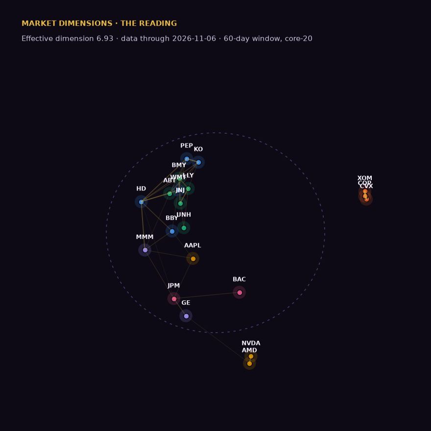

# The Reading — November 7, 2026

*Data through 2026-11-06. Conditions: **sunlight** (VIX 14.21). Paper experiment; research and education, not investment advice.*

## Where it fed this week

The pocket is still NVDA and AMD. The tissue closest to it: TSM (0.98), ETN (0.89), SMCI (0.86), ANET (0.80). The body (core-20) moved +4.0% over four weeks.

**Feeding now** — score rising and outrunning the body:

- nothing qualifies this week

**Dieback** — falling score, price sagging as if the food ran out:

- **TSM** — score 0.98 (-0.01 on the week), -16.8% over four weeks
- **ANET** — score 0.80 (-0.05 on the week), -21.4% over four weeks
- **AVGO** — score 0.72 (-0.00 on the week), -19.2% over four weeks

**More food than we thought** — pruned names beating the feeding arm since entry:

- **VST** — -11.5% since 2026-08-25 vs feeding arm -16.8%
- **CEG** — -9.6% since 2026-08-25 vs feeding arm -16.8%

_Why is that little pocket of food hitting like it is? (CEO answers in the verdict.)_

## The body, in one breath

Effective dimension **6.93** (-1.46 on the week) — narrowing — watch the trend, not the level. Mean correlation 0.097; separation 1.335; vorticity 0.943 (migration complete / rotation).

## Movers — who drifted toward whom

Largest week-over-week changes in 60-day pairwise correlation:

- **MMM–ABT** tightened: ρ 0.40 (+0.31)
- **AAPL–MMM** tightened: ρ 0.43 (+0.30)
- **JPM–MMM** tightened: ρ 0.44 (+0.29)
- **COP–ABT** loosened: ρ -0.12 (-0.30)
- **XOM–ABT** loosened: ρ -0.13 (-0.27)
- **COP–MMM** loosened: ρ -0.36 (-0.26)

## Tripwires

- ⚠ T1 vorticity 0.943 > 0.92 - migration complete; river dissolving into rotation
- note: 356.69 pair ratio at 0.869 (moved >10% from parity)

## The paper experiment

**Pretend dollars, no real positions.** Since entry on 2026-08-25:

| Arm | Names | Paper return since 8/25 |
|---|---|---|
| Feeding ground | TSM, VRT, AVGO, ANET, ETN | -16.8% (TSM -10.1, VRT -29.0, AVGO -17.9, ANET -10.6, ETN -16.6) |
| AI pocket | NVDA, AMD | -9.5% (NVDA -12.0, AMD -7.0) |
| Pruned | VST, CEG | -10.5% (VST -11.5, CEG -9.6) |
| Plumbing | JPM | -5.5% (JPM -5.5) |

356.69 pair (AVGO/JPM): **0.8688** (-13.12% vs parity) — PAIR-1 says it rises in sunlight.

## Ledger

12 registered claims, 0 final grades. Coming due: PROC-2 due 2026-11-28.

Grades are append-only. [Read the ledger](https://icburg27.github.io/market-dimensions/ledger/) · [source](https://github.com/icburg27/vitals-machine)

## VERDICT

_The CEO writes this — the story of the week in the slime mold's terms: why the food is where it is. Reply on the issue with a comment beginning `VERDICT:` and the letter publishes with that text here._

---

*Market Dimensions is research and education, not investment advice. The portfolio above is a paper experiment. Operated under the AI Formation Governance Standard by The AI Governance Company — self-governed in public, not third-party certified.* [Unsubscribe]({{ unsubscribe_url }})
