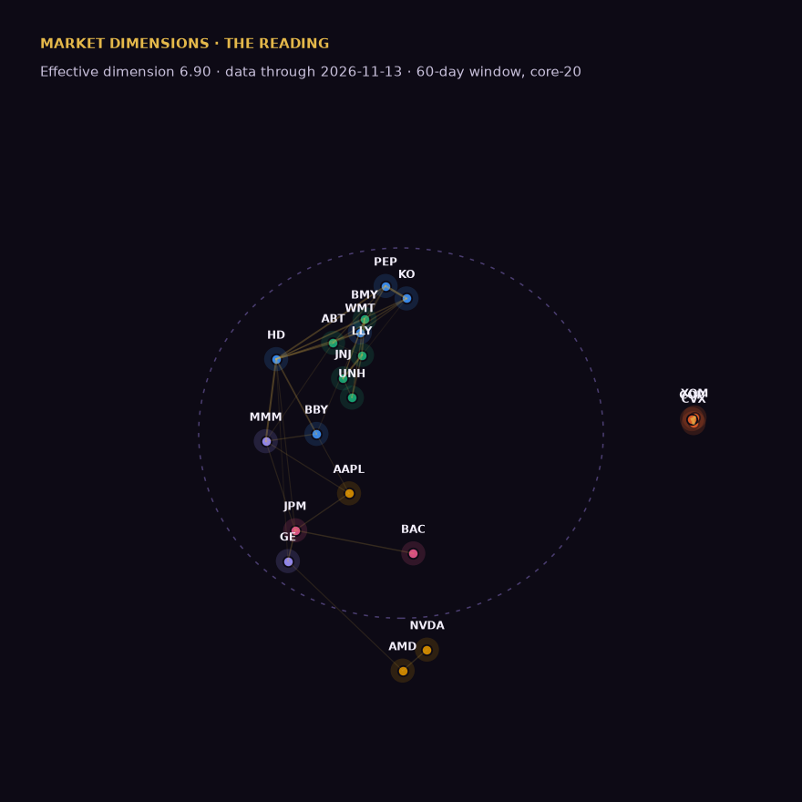

# The Reading — November 14, 2026

*Data through 2026-11-13. Conditions: **sunlight** (VIX 14.21). Paper experiment; research and education, not investment advice.*

## Where it fed this week

The pocket is still NVDA and AMD. The tissue closest to it: TSM (0.94), ETN (0.88), ANET (0.82), SMCI (0.78). The body (core-20) moved +3.5% over four weeks.

**Feeding now** — score rising and outrunning the body:

- **ANET** — score 0.82 (+0.02 on the week), +9.7% over four weeks
- **AVGO** — score 0.75 (+0.03 on the week), +3.8% over four weeks

**Dieback** — falling score, price sagging as if the food ran out:

- **TSM** — score 0.94 (-0.04 on the week), -4.1% over four weeks
- **ETN** — score 0.88 (-0.01 on the week), -11.3% over four weeks
- **SMCI** — score 0.78 (-0.08 on the week), -16.2% over four weeks
- **VRT** — score 0.75 (-0.01 on the week), -4.2% over four weeks
- **VST** — score 0.66 (-0.00 on the week), -13.8% over four weeks
- **NVDA** — score 0.59 (-0.20 on the week), -25.1% over four weeks
- **AMD** — score 0.56 (-0.21 on the week), -1.6% over four weeks

**More food than we thought** — pruned names beating the feeding arm since entry:

- **VST** — -4.3% since 2026-08-25 vs feeding arm -7.7%
- **CEG** — +0.7% since 2026-08-25 vs feeding arm -7.7%

_Why is that little pocket of food hitting like it is? (CEO answers in the verdict.)_

## The body, in one breath

Effective dimension **6.90** (-0.03 on the week) — narrowing — watch the trend, not the level. Mean correlation 0.101; separation 1.243; vorticity 0.986 (migration complete / rotation).

## Movers — who drifted toward whom

Largest week-over-week changes in 60-day pairwise correlation:

- **GE–LLY** tightened: ρ 0.06 (+0.15)
- **AMD–JNJ** tightened: ρ -0.08 (+0.12)
- **AMD–LLY** tightened: ρ -0.08 (+0.12)
- **AMD–NVDA** loosened: ρ 0.47 (-0.21)
- **XOM–GE** loosened: ρ -0.50 (-0.09)
- **CVX–GE** loosened: ρ -0.46 (-0.09)

## Tripwires

- ⚠ T1 vorticity 0.986 > 0.92 - migration complete; river dissolving into rotation
- ⚠ T2 DISEASE SIGNATURE: eff_dim < 75% of trailing max for 3 consecutive readings (now 6.9) - the 2007 pattern

## The paper experiment

**Pretend dollars, no real positions.** Since entry on 2026-08-25:

| Arm | Names | Paper return since 8/25 |
|---|---|---|
| Feeding ground | TSM, VRT, AVGO, ANET, ETN | -7.7% (TSM -4.5, VRT -20.9, AVGO -2.7, ANET +3.3, ETN -13.6) |
| AI pocket | NVDA, AMD | -6.1% (NVDA -23.5, AMD +11.4) |
| Pruned | VST, CEG | -1.8% (VST -4.3, CEG +0.7) |
| Plumbing | JPM | -2.9% (JPM -2.9) |

356.69 pair (AVGO/JPM): **1.0024** (+0.24% vs parity) — PAIR-1 says it rises in sunlight.

## Ledger

12 registered claims, 0 final grades. Coming due: PROC-2 due 2026-11-28; PROC-3 due 2026-12-26.

Grades are append-only. [Read the ledger](https://icburg27.github.io/market-dimensions/ledger/) · [source](https://github.com/icburg27/vitals-machine)

## VERDICT

_The CEO writes this — the story of the week in the slime mold's terms: why the food is where it is. Reply on the issue with a comment beginning `VERDICT:` and the letter publishes with that text here._

---

*Market Dimensions is research and education, not investment advice. The portfolio above is a paper experiment. Operated under the AI Formation Governance Standard by The AI Governance Company — self-governed in public, not third-party certified.* [Unsubscribe]({{ unsubscribe_url }})
