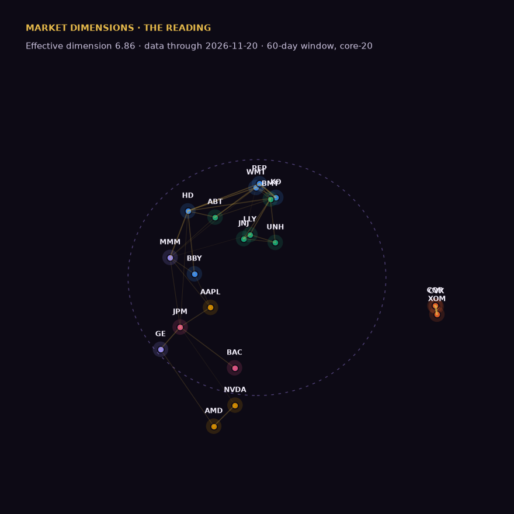

# The Reading — November 21, 2026

*Data through 2026-11-20. Conditions: **sunlight** (VIX 14.21). Paper experiment; research and education, not investment advice.*

## Where it fed this week

The pocket is still NVDA and AMD. The tissue closest to it: TSM (0.86), ETN (0.84), ANET (0.81), AVGO (0.78). The body (core-20) moved -4.7% over four weeks.

**Feeding now** — score rising and outrunning the body:

- nothing qualifies this week

**Dieback** — falling score, price sagging as if the food ran out:

- **TSM** — score 0.86 (-0.08 on the week), -24.0% over four weeks
- **ETN** — score 0.84 (-0.04 on the week), -15.7% over four weeks
- **SMCI** — score 0.74 (-0.04 on the week), -36.2% over four weeks
- **VRT** — score 0.73 (-0.02 on the week), -15.3% over four weeks
- **VST** — score 0.64 (-0.02 on the week), -18.4% over four weeks
- **NVDA** — score 0.59 (-0.00 on the week), -40.8% over four weeks
- **CEG** — score 0.53 (-0.03 on the week), -7.1% over four weeks

**More food than we thought** — pruned names beating the feeding arm since entry:

- **VST** — -17.1% since 2026-08-25 vs feeding arm -21.9%
- **CEG** — -14.7% since 2026-08-25 vs feeding arm -21.9%

_Why is that little pocket of food hitting like it is? (CEO answers in the verdict.)_

## The body, in one breath

Effective dimension **6.86** (-0.07 on the week) — narrowing — watch the trend, not the level. Mean correlation 0.131; separation 1.315; vorticity 0.98 (migration complete / rotation).

## Movers — who drifted toward whom

Largest week-over-week changes in 60-day pairwise correlation:

- **CVX–UNH** tightened: ρ 0.12 (+0.32)
- **XOM–UNH** tightened: ρ 0.04 (+0.27)
- **COP–UNH** tightened: ρ 0.06 (+0.22)
- **AMD–WMT** loosened: ρ -0.42 (-0.15)
- **WMT–GE** loosened: ρ 0.02 (-0.12)
- **BBY–WMT** loosened: ρ 0.28 (-0.10)

## Tripwires

- ⚠ T1 vorticity 0.98 > 0.92 - migration complete; river dissolving into rotation
- ⚠ T2 DISEASE SIGNATURE: eff_dim < 75% of trailing max for 3 consecutive readings (now 6.86) - the 2007 pattern

## The paper experiment

**Pretend dollars, no real positions.** Since entry on 2026-08-25:

| Arm | Names | Paper return since 8/25 |
|---|---|---|
| Feeding ground | TSM, VRT, AVGO, ANET, ETN | -21.9% (TSM -23.6, VRT -35.0, AVGO -14.7, ANET -12.2, ETN -23.8) |
| AI pocket | NVDA, AMD | -26.3% (NVDA -41.1, AMD -11.4) |
| Pruned | VST, CEG | -15.9% (VST -17.1, CEG -14.7) |
| Plumbing | JPM | -12.9% (JPM -12.9) |

356.69 pair (AVGO/JPM): **0.9803** (-1.97% vs parity) — PAIR-1 says it rises in sunlight.

## Ledger

12 registered claims, 0 final grades. Coming due: PROC-2 due 2026-11-28; PROC-3 due 2026-12-26.

Grades are append-only. [Read the ledger](https://icburg27.github.io/market-dimensions/ledger/) · [source](https://github.com/icburg27/vitals-machine)

## VERDICT

_The CEO writes this — the story of the week in the slime mold's terms: why the food is where it is. Reply on the issue with a comment beginning `VERDICT:` and the letter publishes with that text here._

---

*Market Dimensions is research and education, not investment advice. The portfolio above is a paper experiment. Operated under the AI Formation Governance Standard by The AI Governance Company — self-governed in public, not third-party certified.* [Unsubscribe]({{ unsubscribe_url }})
